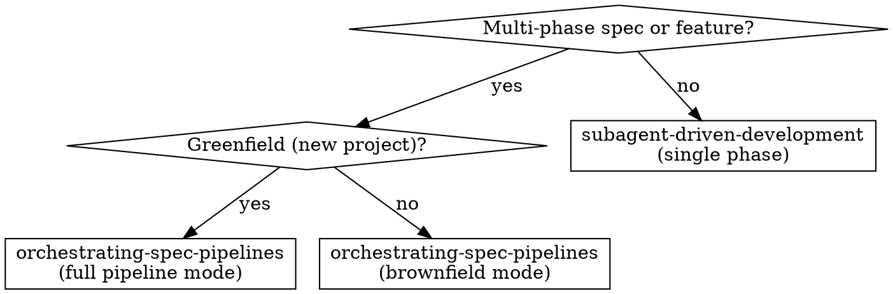

# Orchestrating Spec Pipelines

## Overview

Execute multi-phase specs by dispatching phases to subagents, tracking
progress in a state file, and resolving design deadlocks via parallel role
simulation. Greenfield projects go through full spec→plans→execute;
brownfield features skip the spec ceremony and extract phases directly
from the request.

**Core principle:** The orchestrator dispatches, tracks, and resolves.
Subagents implement. State file survives context compaction.

## When to Use



**Use when:**
- Spec covers multiple independent subsystems (auth, chat, upload, sync)
- Feature request in existing codebase decomposes into 3+ phases
- You need autonomous execution that survives session restarts
- A subagent blocks on "should we use approach A or B?"

**Don't use when:**
- Single-phase spec → subagent-driven-development directly
- Two small, tightly-coupled phases → inline execution is simpler
- All phases are purely sequential with no parallelism possible → simpler loop

## Entry Paths

### Greenfield Mode

1. **REQUIRED SUB-SKILL:** Use superpowers:brainstorming to create the spec
2. Spec → design doc committed to `docs/superpowers/specs/`
3. **REQUIRED SUB-SKILL:** Use superpowers:writing-plans to create phase plans
4. Each phase gets its own plan file at `docs/superpowers/plans/phase-N-<name>.md`
5. Transition to the Ralph Loop

### Brownfield Mode

1. Extract phases from user's feature request (no spec document needed)
2. Write lightweight phase plans — each a focused file specifying what to build
3. Same execution quality (TDD, review, verification) but less ceremony
4. Transition to the Ralph Loop

## Ralph Loop Orchestrator

```
for each cycle:
  1. Read .superpowers/pipeline/state.md
  2. Identify ready phases (all Depends are "complete")
  3. Dispatch:
     - Single ready phase → sequential dispatch
     - Multiple ready phases with disjoint files → parallel dispatch
     - Multiple ready phases with overlapping files → sequential (dependency order)
  4. Wait for all dispatched subagents to return
  5. Handle results:
     - DONE → update state, record commits
     - BLOCKED + design ambiguity → role simulation (see below)
     - BLOCKED + technical → fix loop (3 rounds), then escalate
  6. Repeat until all phases complete
```

**Parallel dispatch:** Spawn multiple task subagents in a single message. Each
gets its phase plan file + interfaces from completed phases. They share no
state beyond what you provide.

**Sequential dispatch:** One task subagent at a time. The next phase's dispatch
includes interfaces produced by the just-completed phase.

**Phase dispatch template:** [ralph-loop-prompt.md](ralph-loop-prompt.md)

**State file format:** [state-file-schema.md](state-file-schema.md)

### Recovery

After context compaction or session restart:
```bash
cat .superpowers/pipeline/state.md
```
Find the first phase with `Status: pending` or `Status: in_progress`. Resume there.

### Context Budget Guard

Before dispatching any phase, check its plan file size. If the phase plan
exceeds 40% of the context window, split it into sub-phases before dispatch.
A subagent drowning in plan text cannot implement well.

## Role-Based Decision Fallback

When a phase subagent returns BLOCKED with a design ambiguity (two viable
approaches, unclear tradeoff):

1. Dispatch 4 parallel task subagents — one per role: CEO, Designer, Engineer, Security
2. Each receives the blocker text + their role lens
3. Synthesize verdicts: majority wins, 2-2 ties broken by Engineer+CEO override
4. Record decision in state file, re-dispatch phase with resolved choice

Full protocol: [role-simulation.md](role-simulation.md)

Fast-path skip: if the blocker has one obviously correct answer, decide inline.

## Quick Reference

| Situation | Action |
|-----------|--------|
| New project, multi-phase spec | Greenfield mode: brainstorming → writing-plans → Ralph Loop |
| Existing codebase, feature request | Brownfield mode: extract phases → light plans → Ralph Loop |
| Single ready phase | Sequential dispatch |
| 3 ready phases, disjoint files | Parallel dispatch |
| Phase BLOCKED, design ambiguity | Role simulation (4 parallel subagents) |
| Phase BLOCKED, technical issue | Fix loop (3 rounds), then escalate |
| Session restarted, lost context | `cat state.md`, resume from first non-complete phase |
| Phase plan >40% of context | Split into sub-phases before dispatch |

## Integration with Existing Skills

- **REQUIRED:** brainstorming — greenfield spec creation
- **REQUIRED:** writing-plans — phase plan generation
- **REQUIRED:** subagent-driven-development — per-phase implementation + review
- **REQUIRED:** test-driven-development — enforced within each phase
- **REQUIRED:** dispatching-parallel-agents — parallel phase dispatch + role simulation
- **REQUIRED:** finishing-a-development-branch — final merge and cleanup
- **REQUIRED:** using-git-worktrees — isolated workspace per pipeline

## Common Mistakes

| Mistake | Fix |
|---------|-----|
| Dispatching all phases in parallel regardless of file overlap | Check file sets — overlapping files = sequential |
| Letting the orchestrator implement code itself | Never. Dispatch subagents for all implementation work |
| Skipping the context budget check | 40% max per phase. Split larger phases |
| Using role simulation for technical blockers | Role sim is for design ambiguity only, not missing deps |
| Re-dispatching completed phases after session restart | Read state.md first — `complete` means done |
| Writing phase plans lazily (one at a time) | Pre-write all plans. Amend later if needed via state file |
